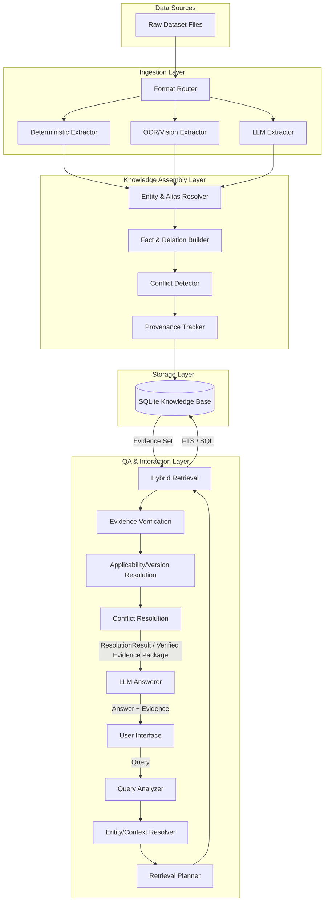

# Aegis Series-7 HCS Knowledge System Architecture

## 1. Problem Definition
The system must ingest a heterogeneous dataset of 20 fictional industrial documents (PDFs, HTML, DOCX, XLSX, PNGs) containing messy, conflicting, and version-scoped information about the Aegis Series-7 Hydraulic Control System. It must transform these raw files into a structured, provenance-preserving knowledge representation and expose a query interface that answers natural-language questions with hard evidence, safe abstention, and explicitly deterministic resolution of conflicts/versions.

## 2. Design Goals
- **Accuracy & Evidence First**: Every claim must be tied to a precise source. The LLM synthesizes from verified evidence and never acts as the source of truth, nor does it resolve conflicts independently.
- **Traceability**: End-to-end provenance linking every fact and relationship to its original document, page, and extraction method.
- **Explicit Ambiguity**: Conflicts, versions, and uncertain entity aliases are explicitly modeled and preserved.
- **Modularity & Simplicity**: A modular monolith architecture utilizing clear, typed interfaces. Initial storage is SQLite. No unnecessary microservices.
- **Security**: The QA layer has read-only access to the knowledge base; raw text is treated as untrusted data.
- **Data Preservation**: Noise classification down-ranks documents during retrieval based on relevance, but all files are ingested and retained; nothing is discarded.

## 3. Architecture Overview

## 4. Component Responsibilities
- **Ingestion Layer**: Reads raw files, preserves them unaltered, and applies specific extraction strategies based on file format.
- **Knowledge Assembly Layer**: Structures extracted text into typed models (Entities, Facts, Aliases, Relations).
- **Retrieval Layer**: Locates raw facts based on a strict priority (Exact lookup > Structured fact lookup > FTS5 Lexical > Semantic/Vector).
- **Evidence Verification Component**: A deterministic rule-based engine positioned between Retrieval and the LLM. It generates auditable `ResolutionResult` objects by explicitly resolving which facts apply based on entity identity, context, applicability, dates, extraction reliability, and source authority.
- **QA Layer (LLM Answerer)**: Receives the `ResolutionResult / Verified Evidence Package`. Restricted to synthesizing a final, natural-language answer strictly from this package without deciding the underlying truth.

## 5. Data Flow
1. **Ingest**: File metadata is recorded. Content is extracted deterministically or via models.
2. **Transform**: Extracted content is parsed into Entities and Facts. Provenance is attached.
3. **Resolve**: Entity matching algorithms flag aliases with a defined confidence and resolution method.
4. **Store**: Records are committed to the Knowledge Base.
5. **Analyze**: User queries are explicitly analyzed for context (e.g., requested FW revision, component, historical vs. current state).
6. **Retrieve**: Hybrid retrieval pulls candidate evidence.
7. **Verify & Resolve**: Candidate evidence undergoes Evidence Verification, Applicability, and Conflict Resolution. This produces a `ResolutionResult`.
8. **Answer**: The LLM Answerer synthesizes the final response strictly from the `ResolutionResult`, citing evidence, or abstains if insufficient.

## 6. Ingestion Architecture
- **Format Router**: Dispatches files based on MIME type.
- **Deterministic Processors**: Used for JSON, XLSX, and structured HTML. High extraction reliability.
- **Vision/OCR Processors**: Used for PNGs and scanned PDFs. 
- **Text Models**: Used for extracting semantic relationships.
*Noise Strategy*: Documents can have an `OFFICIAL`, `INFORMAL`, or `UNVERIFIED` authority. A separate `relevance_score` is used to flag noise. Irrelevant files are never discarded; they are simply down-ranked in normal retrieval.

## 7. Knowledge Representation
The schema uses explicit typed models. The `Fact` model uses an `ASSERTED / CONTESTED / WITHDRAWN` status. Historical facts remain `ASSERTED` because truth is contextual; the `Validity` bounds are used at query time to determine applicability. 

## 8. Entity Resolution
Entity resolution is handled probabilistically but stored explicitly.
- Distinct entities (`PS-04`, `PS-04A`, `PS-40`) are never merged.
- `Alias` models link generic terms to a canonical entity using `confidence` and `resolution_method` (e.g., EXACT, REGISTER, DOCUMENT, CONTEXT, MODEL).

## 9. Version Handling and Query Context
Information is version-scoped using a `Validity` model attached to `Fact`. 
- The **Query Analyzer** determines explicit requested context (FW revision, historical state, time/date). It never assumes "current" unless the question dictates it.
- The **Applicability Resolver** filters retrieved facts based on their `fw_version_min/max` and `date_effective`.

## 10. Conflict Handling
Conflicts are modeled explicitly via a `Conflict` relation.
- The LLM does **not** resolve conflicts.
- The **Conflict Resolution** component deterministically evaluates conflicts without relying on a universal "OFFICIAL > UNVERIFIED" rule. It considers entity identity, applicability, software revision, effective date, query context, source authority, and extraction reliability. 
- It generates a `ResolutionResult` deciding whether to `SELECT` a fact, preserve it as `CONFLICTED`, or declare `INSUFFICIENT_EVIDENCE`.

## 11. Provenance
Every `Fact` and `Relation` is linked back to an `Evidence` object pointing to a `DocumentLocation` and an `ExtractionResult` (the raw text/chunk and method used). This prevents circular dependencies.

## 12. Retrieval
A hybrid approach ensures high recall and precision. Priorities are explicitly defined:
1. **Exact entity/identifier lookup**: Searching structured aliases and entities.
2. **Structured fact lookup**: Querying by subject/predicate/value.
3. **SQLite FTS5 Lexical Retrieval**: Keyword searching across extraction results.
4. **Semantic / Vector Retrieval**: (Optional) Used only where useful; vector search is not mandatory.

## 13. QA
The LLM Answerer receives the `ResolutionResult / Verified Evidence Package` from the deterministic pipeline. Its only job is to synthesize a human-readable answer, list the supporting claims, and link the provided evidence. It must never act as the source of truth or decide which underlying fact is authoritative.

## 14. Abstention
The system enforces safe abstention. If the Conflict Resolution outputs a `ResolutionResult` with `INSUFFICIENT_EVIDENCE` or `NOT_APPLICABLE`, the QA Agent is strictly instructed to output: *"Cannot determine from the supplied documentation."*

## 15. Security
- **Read-Only Access**: The entire retrieval, verification, and QA pipeline has no database write credentials.
- **Untrusted Input**: Document text is treated as potentially hostile. Document instructions cannot override system instructions.
- **No Secrets**: Configuration and API keys are injected via environment variables.

## 16. Evaluation Architecture
An evaluation harness maps the 23 benchmark questions against the end-to-end endpoint. It evaluates:
- **Accuracy**: Does the answer match the expected value?
- **Provenance**: Are the correct sources cited?
- **Abstention**: Does the system correctly refuse to answer unanswerable questions?

## 17. Scalability Strategy
The system is designed as a modular monolith. 
- Initial deployment uses SQLite with FTS5.
- The storage layer abstracts the SQL dialect, allowing migration to PostgreSQL in the future without changing the knowledge representation.

## 18. Failure Modes
- **Extraction Failure**: Complex diagrams may yield noisy text. *Mitigation: Store extraction reliability scores; use Vision LLMs.*
- **False Entity Merging**: *Mitigation: Strict prohibition on silent merging; all aliases require explicit, reviewable alias models.*
- **Retrieval Misses**: *Mitigation: Priority-based hybrid search.*

## 19. Design Trade-offs
- **Deterministic Resolution vs LLM Reasoning**: Pushing conflict resolution into deterministic components requires explicit `ResolutionResult` auditing, but it guarantees traceability and eliminates LLM hallucinations in truth determination.
- **Relational vs Graph Database**: A relational model (SQLite) is chosen for operational simplicity, handling graph traversals via JOIN tables.

## 20. What is Intentionally Not Implemented
- **LLM Conflict Resolution**: The QA LLM is intentionally prohibited from deciding the truth.
- **Automated Knowledge Base Modification**: Ingestion is a controlled, one-way pipeline.
- **Unnecessary Microservices**: The system is a single application boundary.
